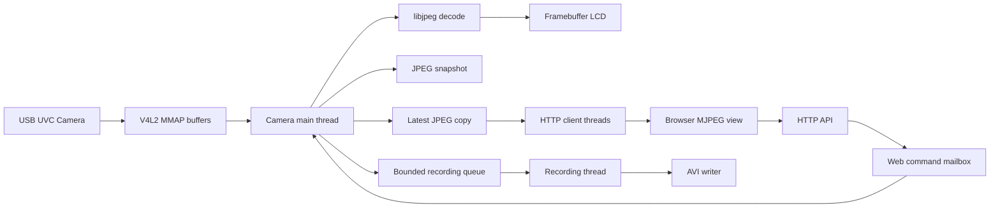

# i.MX6ULL V4L2 网络摄像头综合项目

基于韦东山/百问网 i.MX6ULL Pro 开发板完成的嵌入式 Linux 摄像头项目。项目从 V4L2 设备能力探测开始，逐步实现 LCD 实时预览、JPEG 抓拍、HTTP MJPEG 多客户端传输、异步 AVI 录像、USB 摄像头热插拔恢复，以及浏览器远程控制。

仓库按照学习过程保留 18 个独立阶段。每个阶段都包含可单独编译的源码和 Makefile，既能展示最终功能，也能追踪功能如何逐步演进。

## 最终功能

- V4L2 MMAP streaming 采集 USB UVC 摄像头 MJPEG 帧。
- libjpeg 解码 MJPEG，并在 `/dev/fb0` 上进行 1024×600、32 bpp LCD 预览。
- 终端与浏览器 JPEG 抓拍。
- HTTP MJPEG 实时视频，最多支持 4 个并发客户端。
- 独立录像线程、8 帧有界队列和录像丢帧统计。
- 将完整 JPEG 帧封装为带 `hdrl`、`movi`、`idx1` 的 AVI 1.0 文件。
- 摄像头拔出后释放旧资源，重新插入后自动恢复采集。
- 枚举、读取和设置 V4L2 控制项。
- 浏览器控制亮度、自动白平衡和手动色温。
- 浏览器查询摄像头状态、控制抓拍和切换录像。

## 硬件与软件环境

| 项目 | 配置 |
| --- | --- |
| 开发板 | 100ASK i.MX6ULL Pro，512 MiB DDR |
| Linux 内核 | 4.9.88 |
| 根文件系统 | Buildroot / BusyBox |
| 摄像头 | USB 2.0 UVC Camera，MJPG 640×480 |
| 显示设备 | `/dev/fb0`，1024×600，32 bpp，stride 4096 |
| 交叉编译器 | `arm-buildroot-linux-gnueabihf-gcc` 7.5.0 |
| 主要依赖 | pthread、libjpeg |

## 系统架构



核心并发原则：只有摄像头主线程直接使用 V4L2 帧。HTTP 线程复制最新 JPEG，录像线程消费独立队列，网页控制线程只提交命令，避免在 `VIDIOC_QBUF` 归还缓冲区后继续访问驱动缓冲区。

## 阶段目录

| 阶段 | 目录 | 内容 |
| --- | --- | --- |
| 01 | `01_device_probe` | 查询驱动、采集能力和像素格式 |
| 02 | `02_single_frame_capture` | MMAP streaming 采集一帧 MJPEG |
| 03 | `03_continuous_capture` | 连续采集、归还缓冲区并统计帧率 |
| 04 | `04_frame_interval_probe` | 枚举 MJPG 640×480 支持的帧率 |
| 05 | `05_current_frame_interval` | 查询当前帧间隔 |
| 06 | `06_frame_rate_control` | 设置 20/30 fps 并检查序号跳跃 |
| 07 | `07_local_preview` | MJPEG 解码与 LCD 实时预览 |
| 08 | `08_snapshot_preview` | 预览过程中保存 JPEG |
| 09 | `09_network_preview` | 单客户端 HTTP MJPEG 预览 |
| 10 | `10_camera_recovery` | USB 摄像头断开与自动重连 |
| 11 | `11_mjpeg_recording` | MJPEG 原始流连续录像 |
| 12 | `12_async_recording` | 有界队列和独立录像线程 |
| 13 | `13_avi_recording` | MJPEG 帧封装为 AVI 1.0 |
| 14 | `14_v4l2_controls` | 枚举摄像头控制项 |
| 15 | `15_v4l2_control_set` | 参数校验、设置与回读 |
| 16 | `16_multi_client_http` | 最多 4 路 HTTP MJPEG 客户端 |
| 17 | `17_web_control` | Web 状态、抓拍与录像控制 |
| 18 | `18_web_camera_controls` | Web 亮度和白平衡控制 |

## 构建最终阶段

在配置好交叉编译器和 libjpeg sysroot 的 Ubuntu 主机中执行：

```sh
cd v4l2_project
make
```

也可以直接进入最终阶段：

```sh
cd 18_web_camera_controls
make
```

生成文件：

```text
18_web_camera_controls/camera_web_controls
```

## 部署与运行

```sh
adb shell mkdir -p /root/hcm/18_web_camera_controls
adb push 18_web_camera_controls/camera_web_controls \
    /root/hcm/18_web_camera_controls/
```

开发板执行：

```sh
cd /root/hcm/18_web_camera_controls
./camera_web_controls \
    /dev/v4l/by-id/usb-lihappe8_Corp._USB_2.0_Camera-video-index0 \
    /dev/fb0
```

终端命令：

- `s`：抓拍。
- `r`：开始或停止 AVI 录像。
- `q`：退出程序。

浏览器访问：

```text
http://<board-ip>:8080/
```

直接视频流：

```text
http://<board-ip>:8080/stream
```

## HTTP API

| 方法 | 路径 | 功能 |
| --- | --- | --- |
| GET | `/` | 返回内置控制页面 |
| GET | `/stream` | MJPEG 实时视频 |
| GET | `/api/status` | 摄像头、录像和抓拍状态 |
| GET | `/api/controls` | 当前亮度和白平衡状态 |
| POST | `/api/snapshot` | 提交抓拍命令 |
| POST | `/api/record/toggle` | 开始或停止录像 |
| POST | `/api/control?id=<ID>&value=<值>` | 设置摄像头参数 |

## 实测结果

- 摄像头驱动：`uvcvideo`。
- 支持格式：YUYV、MJPG，使用 streaming I/O。
- 20 fps 请求下实测稳定约 19.90 fps，驱动序号跳跃为 0。
- 30 fps 请求下实测约 24.95 fps，驱动序号跳跃为 0。
- LCD 预览、抓拍、MJPEG 网络预览和 AVI 录像均已验证。
- 摄像头拔出并重新插入后可自动恢复预览。
- 实测 10 个 V4L2 控制项；亮度、自动白平衡和手动色温设置与回读正常。
- 浏览器视频、状态查询、抓拍、录像和参数控制均已验证。

## 设计要点

- V4L2 缓冲区归还前完成显示、抓拍和必要的数据复制。
- 网络慢客户端只读取最新帧，不反向阻塞摄像头采集。
- 录像线程与采集线程解耦；队列满时记录丢帧而不是无限占用内存。
- HTTP 线程只提交设备控制命令，由摄像头主线程执行 V4L2 ioctl。
- 使用 `/dev/v4l/by-id/` 稳定设备路径，避免重连后 `/dev/videoN` 编号变化。

## 当前限制

- 固定使用 MJPG 640×480、20 fps。
- AVI 使用传统 `idx1` 索引，单个录像限制约 100 MiB。
- 最多 4 个并发 HTTP 客户端。
- Web 页面面向可信局域网，没有身份认证和 HTTPS，禁止直接暴露到公网。
- 控制项与当前 UVC 摄像头能力相关，其他型号需要重新枚举和适配。
- 工程面向 Linux 4.9.88 和 framebuffer，未迁移到 DRM/KMS、GStreamer 或硬件 H.264 编码。

## 项目定位

该项目用于学习与展示嵌入式 Linux 应用开发，覆盖 V4L2、framebuffer、JPEG、Socket/HTTP、pthread、生产者—消费者模型、文件封装、热插拔恢复和浏览器设备控制。
